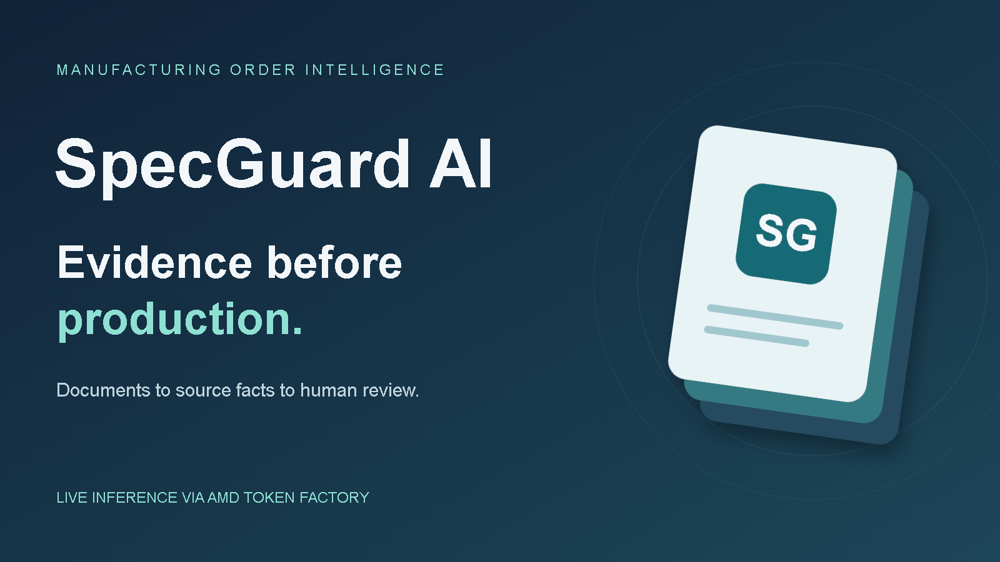

# SpecGuard AI

**Manufacturing Order Intelligence — evidence before production.**

[Open the working app](https://specguard-ai-dev.streamlit.app/) · [Download example documents](https://github.com/minteeqahmed-png/Specguard-ai/raw/refs/heads/main/examples/SpecGuard-Example-Documents.zip) · [Browse the examples](examples/README.md) · [View pitch slides](presentation/SpecGuard-AI-Pitch.pdf)

SpecGuard AI helps a manufacturer's order coordinator compare buyer messages, technical PDFs and size spreadsheets before production. It extracts source-linked facts, flags contradictory requirements and records human decisions without rewriting original evidence. The hosted prototype uses **AMD Token Factory / MiMo-V2.6-Flash** for live extraction.

## Try it in a few minutes

1. Download the [example ZIP](examples/SpecGuard-Example-Documents.zip?raw=true) and extract it.
2. Open the app and choose **Upload documents**. Upload `buyer_order.txt`, `tech_pack.pdf` and `size_quantities.csv` together.
3. Click **Extract facts**, inspect the quotes and locations, then **Compare requirements**.
4. Expect **HOLD** with three deliberate findings:

| Finding | Buyer / size CSV | Technical PDF |
| --- | --- | --- |
| Quantity mismatch | 300 pieces | 280 pieces |
| Color mismatch | black | charcoal |
| Size total mismatch | 300 pieces | 280 pieces |

The same ZIP is available from **Download example documents** in the app's sidebar. All example data is synthetic. [Individual downloads and correction walkthrough](examples/README.md) show how reviewer confirmation can reach READY while retaining the original facts. To try a consistent order, choose **Synthetic sample -> 01_consistent**. READY never authorizes production.



## What works

- Upload UTF-8 TXT/CSV and text-based PDFs with line, page and record references.
- Extract manufacturing requirements and show their literal source evidence.
- Compare quantity, size totals, product, unit, color, material, printing, embroidery, secondary colors and deadlines.
- Distinguish contradictions from missing information and failed/incomplete extraction.
- Record validated human corrections separately and recheck their consistency.
- Download extraction JSON, conflict CSV, full analysis JSON and clarification TXT.

**HOLD** means unresolved critical contradictions. **REVIEW** means required information, a major finding or processing/verification remains incomplete. **READY** means no configured blocker remains; independent human production approval is still required.

## AMD integration and verification

The hosted app runs Live Mode through the authenticated AMD Token Factory API. A hosted TXT/PDF/CSV order was verified on October 16, 2026: all three live extractions passed validation and produced the expected HOLD conflicts. The one observed order took **20.44 seconds**, including network and processing. This is a smoke test, not an accuracy, latency or reliability benchmark. [Actual verification record](results/hosted_live_smoke.json)

Live responses pass Pydantic schema, quoted-evidence and source-location checks. Supported labeled templates and exact `size,quantity` CSVs also undergo independent value and coverage verification. Wrong values, omitted contradictions and changed size rows cannot silently produce READY. Other layouts and free-form prose retain model output for inspection but remain REVIEW because completeness is unverified.

Invalid extraction responses get at most one fresh validation retry. HTTP failures, quota limits and truncated output remain explicit. Live requests never fall back to demo facts. API access alone does not independently verify a GPU model or hardware telemetry.

Demo Mode is a separate deterministic template parser, available locally without an API key. Use the visible mode banner and exported mode to distinguish it from live inference.

## Run locally — Python 3.12

```powershell
git clone https://github.com/minteeqahmed-png/Specguard-ai.git
cd Specguard-ai
git switch main
python -m venv .venv
.\.venv\Scripts\python -m pip install -r requirements.txt
.\.venv\Scripts\python -m streamlit run app.py --server.address=127.0.0.1
```

Open http://localhost:8501. On Linux/macOS use `.venv/bin/python`. Local runs default to Demo Mode. For live use, copy `.env.example` to an untracked `.env`, supply your own private credentials and restart. Never put keys in GitHub. [Cloud/local deployment](docs/deployment.md) · [AMD setup](docs/amd_setup.md)

## Validation

| Check | Observed result | Scope |
| --- | --- | --- |
| Automated tests | 99 passed | Parser, schema, failures, reconciliation, corrections, exports and Streamlit flows |
| Synthetic regression evaluation | 27/27 statuses; 81/81 documents; 399/399 field values | Deterministic templates, not model accuracy |
| Original fault probes | All nine blocked READY | Includes wrong value with a real quote and omitted conflicting quantity |
| Hosted Demo Mode | Uploads, HOLD/READY, review history, reset, four exports and corrupt-file blocking passed | Synthetic browser checks |
| Hosted AMD Live Mode | Three documents verified; all three intended conflicts detected | One synthetic order |

Run the checks:

```powershell
.\.venv\Scripts\python -m pytest -q
.\.venv\Scripts\python -m pip check
.\.venv\Scripts\python scripts/evaluate.py --output results/local_evaluation.json
```

[Results and metric definitions](results/README.md) · [Dataset construction](sample_data/README.md) · [Reliability fixes](docs/reliability-fixes.md). `requirements-lock.txt` captures the tested Windows package environment; `requirements.txt` pins the top-level packages.

## Presentation and submission material

- [Eight-slide pitch PDF](presentation/SpecGuard-AI-Pitch.pdf)
- [Cover image](presentation/cover.png) and [editable vector source](presentation/cover.svg)
- [Submission descriptions and technology tags](docs/submission.md)
- [Demo recording script](docs/demo_script.md)
- [Pitch content and speaker notes](docs/pitch.md)

A recorded demo video and the actual event-form submission remain outstanding. The PDF and cover are completed repository assets; the recording script is not a recorded video.

## Architecture and boundaries

`app.py` provides Streamlit UI. `parser.py` parses bounded inputs; `ai_client.py` extracts and verifies facts; `schemas.py` validates structure; `reconciliation.py` compares source and corrected views; `pipeline.py` preserves failures; `reporting.py` builds exports. [Architecture and rules](docs/architecture.md)

The prototype handles one product/order at a time: at most 12 files / 30 MB total, 10 MB per file, 50 PDF pages and 100,000 extracted characters per document. Live input is limited to 16,000 characters per document and fails rather than silently truncating. No OCR, XLSX, multi-item reconciliation, fuzzy matching or unit conversion. PDF text extraction does not guarantee visual table fidelity.

Review state is session-only and reviewer names are self-entered. There is no built-in login or durable signed audit database. For internal-team use, restrict hosted viewers; public live requests consume shared AMD quota. The Token Factory trial supports development without a production SLA. Broad repeated/adversarial live evaluation, production deployment controls and customer pilot measurements remain future work. Docker packaging is provided but has not passed a local build/runtime check.

Expected benefits and future subscription/per-order pricing remain hypotheses; customer savings and demand have not been measured.

## Development workflow

`main` is the stable default branch. Make changes on a short-lived branch such as `codex/fix-csv-validation`, open a pull request, and merge after the automated checks pass. Delete the feature branch after merging, once no deployment depends on it. A permanent `develop` branch is not needed for this project.

## License

MIT for project code; see [LICENSE](LICENSE) and [third-party licensing notes](docs/licensing.md). PDF reading uses pypdf and fixture generation uses ReportLab. Third-party distributions and model weights retain their own licenses and notices.
