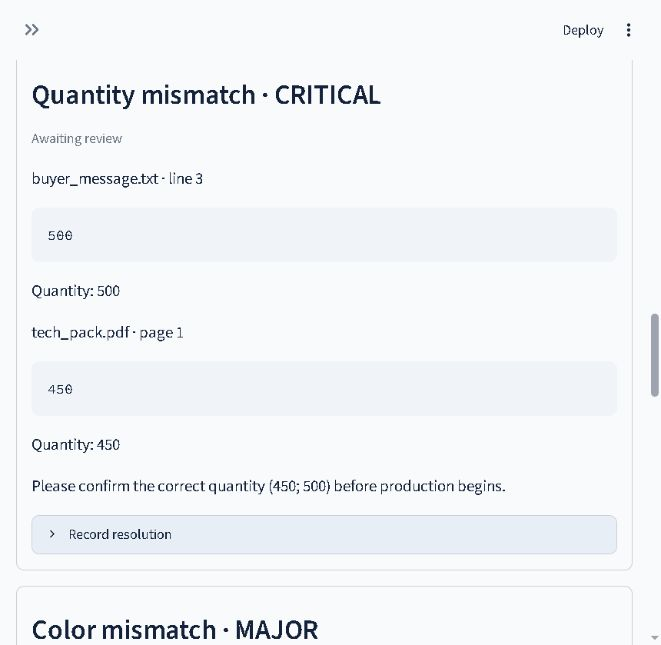

# SpecGuard AI

**Manufacturing Order Intelligence — evidence before production.**

SpecGuard AI compares customer messages, technical PDFs and size spreadsheets before manufacturing begins. It turns document requirements into validated facts, flags contradictions, shows their source evidence and records human decisions without rewriting the original facts.

**Working local MVP with live AMD Token Factory API smoke testing.** Demo Mode is deterministic template extraction and never claims to run AMD inference. Live Mode has processed the synthetic sample order using AMD Token Factory's `MiMo-V2.6-Flash`. Independent GPU execution evidence and broader model evaluation remain outstanding.

## Quick start — Windows / Python 3.12

```powershell
git clone https://github.com/minteeqahmed-png/Specguard-ai.git
cd Specguard-ai
git switch codex/specguard-mvp
python -m venv .venv
.\.venv\Scripts\python -m pip install -r requirements.txt
.\.venv\Scripts\python -m streamlit run app.py
```

Open http://localhost:8501. No account, API key, GPU or paid service is needed for Demo Mode. After the review branch is merged, use main instead of switching branches. On Linux/macOS replace `.\.venv\Scripts\python` with `.venv/bin/python`.

1. Select the initial synthetic sample or upload one order's documents.
2. Click **Extract facts** and inspect the values and source references.
3. Click **Compare requirements**. The initial example produces HOLD for quantity/size conflicts and flags navy versus royal blue.
4. Record corrected values, a reviewer and confirmation notes. Corrections are rechecked separately; original source values remain intact.
5. Record human review and download the reports before closing the session.

## What works

- Multiple UTF-8 TXT/CSV and digital PDF inputs, with previews and filename, line/page/record evidence.
- Errors for empty, corrupt, unsupported, oversized or incorrectly encoded input; warnings for missing CSV cells and unread PDF pages.
- Pydantic-validated extraction with evidence quote checks and independent value/coverage checks for labeled templates and size CSVs. Other live documents remain REVIEW because their extraction completeness is unverified.
- Deterministic quantity, size-total, product, unit, color, material, printing, embroidery, secondary-color and deadline comparisons.
- HOLD for unresolved critical conflicts; REVIEW for major findings, missing mandatory information or incomplete processing; READY only when configured checks clear. **READY never authorizes production.**
- Separate human corrections, reviewer notes, correction validation and review history.
- Extraction JSON, conflict CSV, full-analysis JSON and customer-clarification TXT downloads.
- 27 synthetic evaluation cases, Pytest coverage and GitHub Actions configuration.

## Configuration and AMD

Copy `.env.example` to `.env` only when configuring the live endpoint. The app reads `SPECGUARD_MODE`, `VLLM_BASE_URL`, `VLLM_API_KEY`, `VLLM_MODEL` and `REQUEST_TIMEOUT`. Use `SPECGUARD_MODE=live` to enable real requests; the base URL must include `/v1`. The self-hosted example uses `Qwen/Qwen2.5-7B-Instruct`. For AMD Token Factory, use `https://developer.amd.com.cn/radeon/api/v1`, a privately stored team key, and an available model such as `MiMo-V2.6-Flash`; confirm current availability with **Check model connection**. A timeout of 180 seconds was used for the live smoke test. `DeepSeek-V4-Flash` produced intermittent invalid or omitted facts in these samples, so it is not the current demo choice. Never commit `.env` or API keys.

[AMD setup](docs/amd_setup.md) covers MI300X, ROCm/vLLM, model serving, private SSH forwarding, test requests, telemetry and shutdown. API reachability alone does not prove AMD hardware execution. Invalid extraction JSON, field values or evidence trigger at most one fresh extraction attempt with structural validation feedback. Both attempts undergo the same schema and source-evidence checks. Persistent failures remain explicit and block a complete analysis; no invalid fields are silently discarded and the app never falls back to demo extraction. Network failures, HTTP errors and truncated output are not automatically retried. A validation retry can approximately double a document's request time and token usage.

## Testing and actual evaluation

```powershell
.\.venv\Scripts\python -m pytest -q
.\.venv\Scripts\python -m pip check
.\.venv\Scripts\python scripts/evaluate.py --output results/local_evaluation.json
```

Local validation on October 14, 2026: **86 tests passed** on Windows / Python 3.12.4. Includes parsing, invalid inputs, schema checks, conflicts, missing fields, correction safety, API mocks, bounded extraction retries, rejection of empty live extractions, false-READY regressions, encrypted PDF and page limits, exports and Streamlit extraction/comparison/resolution flows.

The checked-in [demo evaluation](results/demo_evaluation.json) processed **81/81 documents** across **27 cases**: conflict precision/recall/F1 1.0, zero false positives/negatives, 399/399 expected field values matched, and 27/27 expected statuses. The actual run took approximately 0.55 seconds. This is deterministic evaluation on a small constructed template set, **not real-world accuracy, AMD latency or a model benchmark**. The result file records the exact timing and mode.

[Evaluation methodology](results/README.md) explains metric denominators. [Dataset notes](sample_data/README.md) describe case construction and limitations. `requirements-lock.txt` records the tested Windows package environment.

## Architecture and files

Actual local Demo Mode screenshot (synthetic order, October 12, 2026):



`app.py` is the Streamlit interface. `specguard/parser.py` parses inputs; `schemas.py` validates facts; `ai_client.py` handles demo/live extraction; `reconciliation.py` compares facts and corrected views; `pipeline.py` preserves failures; `reporting.py` builds exports; `config.py` loads settings. See the [architecture diagram and rules](docs/architecture.md).

The application holds uploaded documents and review state in memory. It does not silently save private files, send clarification messages or make production decisions. Changing inputs or re-extracting clears prior results and review state.

## Limits and remaining work

One product and one order per analysis. Maximum 12 documents / 30 MB total; 10 MB per file; 50 PDF pages; 100,000 extracted characters per file. Live extraction accepts at most 16,000 characters per document and fails rather than silently truncating. No OCR, XLSX, fuzzy color matching, unit conversion, multi-item reconciliation or persistent signed audit database. PDF table layout can be ambiguous. Matching a quote alone does not prove its interpretation or coverage. Live labeled templates and exact size,quantity CSVs must also match independently parsed source facts, including contradictory lines. Other layouts and free-form prose remain REVIEW even when valid facts are available. Check the originals and supply supported templates to proceed; recording a review cannot bypass this gate. See [reliability fixes](docs/reliability-fixes.md).

Self-hosted AMD serving, independent GPU execution/utilization evidence and broad model accuracy/latency evaluation remain untested. Live Token Factory smoke tests on synthetic documents are not an accuracy benchmark. Docker packaging is supplied but has not been built here. Public hosting, a recorded video, final slides and the event submission are not completed.

## Documentation

- [Local deployment](docs/deployment.md)
- [AMD setup and evidence checklist](docs/amd_setup.md)
- [Architecture](docs/architecture.md)
- [Five-minute demo script](docs/demo_script.md)
- [Pitch content](docs/pitch.md)
- [Development stages](docs/development.md)

Expected business benefits include less manual comparison, clearer customer questions and better traceability. Savings and customer outcomes remain unmeasured. Future per-order or monthly subscription pricing is a hypothesis, not an implemented payment feature.

## License

MIT for project code; see [LICENSE](LICENSE) and [licensing notes](docs/licensing.md). PDF extraction uses pypdf and sample generation uses ReportLab. Third-party packages and model weights retain their own licenses and notices.
