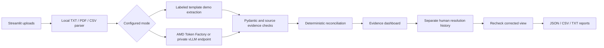

# Architecture and decision rules

`parser.py` retains line, PDF page and CSV record locations. CSV record numbers refer to logical records, not physical lines when quoted multiline cells occur. pypdf extracts text; complex PDF tables are not reconstructed into cells. File bytes are hashed to identify the source version.

`schemas.py` rejects invalid quantities, ambiguous/invalid dates, extra payload properties and empty evidence. Unknown fields are absent, never filled with invented defaults. `ai_client.py` verifies that the quoted text occurs at the supplied source location. It then independently parses supported labeled templates and size,quantity CSVs. Every source fact must match a model field/value and supporting quote; omissions, extra facts, duplicates and changed size rows fail validation. The same bounded retry applies. Live facts are never replaced with template facts. Unrecognized content gets verification=review_required; the pipeline blocks READY while preserving its extraction for inspection. Verification covers parsed template text, not visual PDF fidelity or unrestricted language semantics.

Demo Mode is an explicit template parser. Live Mode sends extracted document text to the configured OpenAI-compatible endpoint and validates every response. HTTP timeouts, inaccessible endpoints, non-JSON results, invalid schema, missing evidence and truncated responses produce failures. No automatic demo fallback is allowed. Live output requests JSON-object mode; support depends on the installed server/model combination.

`pipeline.py` keeps per-document failures and partial results. Any failed document or parser warning blocks READY. A blank PDF page is treated conservatively because unread text could contain requirements.

HTTP 401, 403 and 429 stop further live requests in the order and evaluation batch. Completed extractions remain available; skipped documents receive explicit errors, and evaluation reports list the remaining cases as not run. Ordinary document/schema failures still allow other documents to be checked.

Required order-level fields: product, stated quantity, unit, primary color, material and printing. A required field may appear in any document. A size sum alone does not replace an explicit total. Quantities, products, units, conflicting size tables and size-total mismatches are CRITICAL. Color, material, printing, deadline, embroidery and secondary-color mismatches are MAJOR. Missing mandatory information is MAJOR, distinct from contradiction. Category/instructions remain evidence for human inspection rather than automatic conflict rules. Optional omissions do not block READY.

Matching ignores case and redundant whitespace. Explicit aliases: PCS/piece/pieces; dye sublimation/sublimation; screen-printing/screen printing. Colors have no synonym mapping: navy blue and royal blue remain different. Unit conversion and fuzzy material equivalence are deliberately absent.

Every issue has source values, evidence and a clarification question. Resolutions require a valid corrected value, reviewer and note. They append to a separate history and never overwrite source facts. A derived view applies the latest correction for each issue, then repeats reconciliation. Newly introduced contradictions keep the order blocked. Re-extraction or changing inputs clears results and review state. Export before closing the session; there is no persistent audit database or authenticated signature.

HOLD means an unresolved critical issue. REVIEW means required data, completeness or a major issue is unresolved. READY means these configured checks found no remaining blocker. It is never a production authorization. Human review is recorded separately and cannot override failures or contradictions.

Scope: one product per order, one order per analysis. No OCR, multi-tenant service, login, payments, vector database, autonomous messages or ERP actions. The application cannot verify that a remote endpoint actually runs on AMD; external hardware/process evidence is required.
